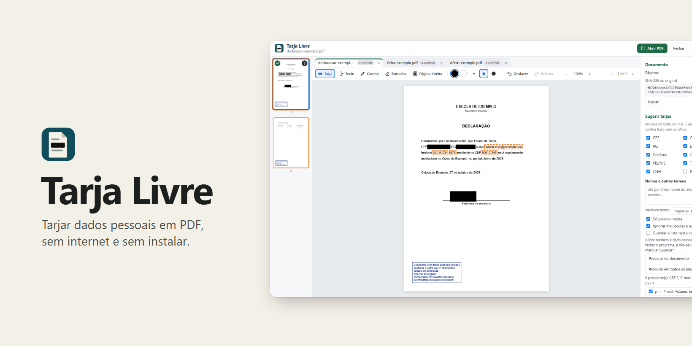
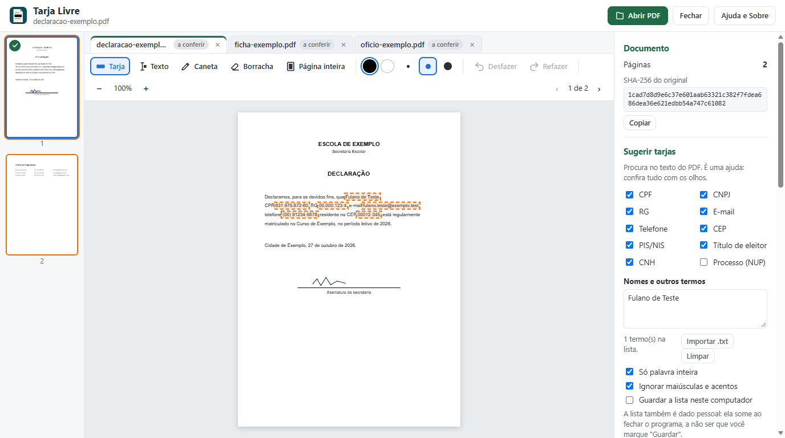
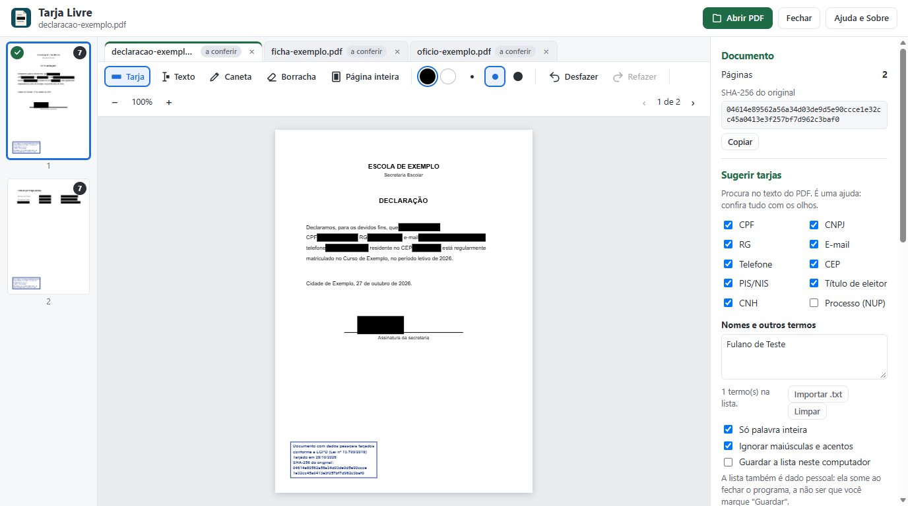
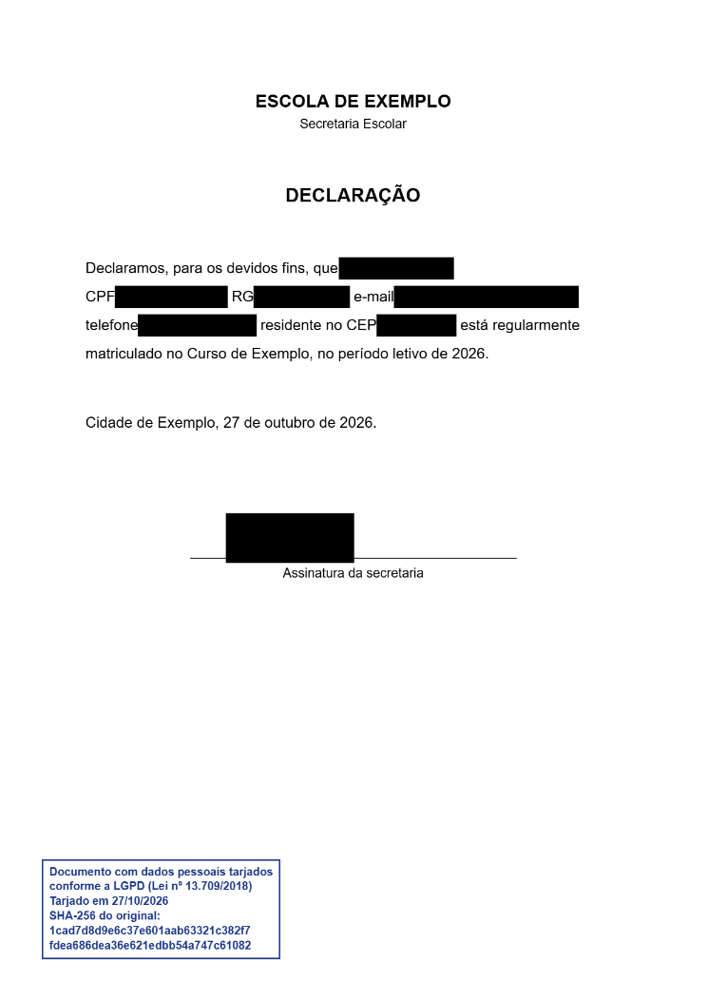

<!-- Tarja Livre — © 2026 Heraldo Antunes — Licença MIT (ver LICENSE) -->
<p align="center"></p>

<h1 align="center">Tarja Livre </h1>

<p align="center"><b>Tarjar dados pessoais em PDF de um jeito que a tarja não sai, para quem precisa compartilhar documentos.</b><br>
Sugere CPF, e-mail, telefone e nomes da sua lista, e refaz cada página como imagem. Livre, gratuito e sem internet.</p>

<p align="center">
  
  
  
  <a href="LICENSE"></a>
  
  <br>
  <a href="https://github.com/HeraldoAntunes/tarja-livre/actions/workflows/testes.yml"></a>
  <a href="https://scorecard.dev/viewer/?uri=github.com/HeraldoAntunes/tarja-livre"></a>
  <a href="https://github.com/HeraldoAntunes/tarja-livre/releases/latest"></a>
  <a href="https://github.com/HeraldoAntunes/tarja-livre/releases"></a>
  <a href="https://doi.org/10.5281/zenodo.23725274"></a>
</p>

<p align="center">
  <a href="https://github.com/HeraldoAntunes/tarja-livre/releases/latest"><b>⬇ Baixar o Tarja Livre</b></a>
  &nbsp;·&nbsp; <a href="docs/GUIA-DE-USO.md">Guia de uso</a>
  &nbsp;·&nbsp; <a href="#programas-livres-">Programas Livres</a>
</p>

<p align="center"></p>

<p align="center">
  <a href="#qual-arquivo-baixar">Baixar</a> · <a href="#como-usar">Como usar</a> · <a href="#recursos">Recursos</a> ·
  <a href="#perguntas-frequentes">Perguntas</a> · <a href="#programas-livres-">Programas Livres</a>
</p>

Abra o PDF, cubra o CPF, o e-mail, a assinatura ou o que precisar, e salve. Cada página é refeita como imagem já com
as tarjas, então o texto coberto deixa de existir no arquivo novo. O documento nunca sai do seu computador.

## Qual arquivo baixar

Os arquivos abaixo são da última versão publicada (versão 1.2.0).

| Para quê | Baixar |
|---|---|
| **Windows: janela própria, se instala sozinho, já com OCR** | [**TarjaLivre-1.2.0.exe**](https://github.com/HeraldoAntunes/tarja-livre/releases/download/v1.2.0/TarjaLivre-1.2.0.exe) (cerca de 11 MB) |
| Usar em qualquer sistema, sem instalar nada: abre no navegador | [**TarjaLivre-1.2.0.html**](https://github.com/HeraldoAntunes/tarja-livre/releases/download/v1.2.0/TarjaLivre-1.2.0.html) (cerca de 2 MB) |
| Também ler PDF digitalizado (OCR, sem internet) | [TarjaLivre-OCR-1.2.0.html](https://github.com/HeraldoAntunes/tarja-livre/releases/download/v1.2.0/TarjaLivre-OCR-1.2.0.html) (cerca de 8 MB) |
| Atalho com o ícone do Tarja para o arquivo HTML (o .exe cria o dele ao instalar) | [Criar-atalho-TarjaLivre.cmd](https://github.com/HeraldoAntunes/tarja-livre/releases/download/v1.2.0/Criar-atalho-TarjaLivre.cmd) (opcional; veja abaixo) |
| Conferir se o arquivo é legítimo | `SHA256SUMS.txt`, na mesma [página da versão](https://github.com/HeraldoAntunes/tarja-livre/releases/latest) |

É um arquivo só: baixe, abra com dois cliques e pronto. Dá para levar num pendrive ou guardar na rede da escola.

**O .exe (Windows)** abre numa janela própria, com o ícone do Tarja na barra de tarefas, sem depender do navegador do
dia a dia (programas de banco que se instalam no navegador não entram nele). Na primeira vez, ele pergunta se instala: **Sim** copia o programa para a sua conta (sem pedir administrador), cria o
atalho **Tarja Livre** no menu Iniciar e na Área de Trabalho e põe o Tarja em **Aplicativos instalados**, de onde se
desinstala; **Não** só usa, sem instalar (bom para pendrive). Na primeira vez, o
Windows também pode avisar que o programa é de editor desconhecido, porque ele não tem assinatura de empresa: clique em
**Mais informações** e em **Executar assim mesmo**. Ele usa o Microsoft Edge WebView2, que já vem no Windows 11 e no
Windows 10 atualizado; se faltar, o próprio programa avisa.

**Ícone na barra de tarefas para o HTML (Windows, opcional):** ponha o `Criar-atalho-TarjaLivre.cmd` na mesma pasta do Tarja e
dê dois cliques. Ele cria o atalho **Tarja Livre** na Área de Trabalho e no menu Iniciar. Clique nele com o botão
direito, depois em **Mostrar mais opções** e em **Fixar na barra de tarefas**. O Windows pode pedir confirmação
antes de rodar o arquivo. Se mudar o Tarja de pasta, rode de novo na pasta nova.
Versões anteriores ficam na [página de versões](https://github.com/HeraldoAntunes/tarja-livre/releases).

- **Grátis e livre:** licença [MIT](LICENSE). Use, copie e distribua à vontade, inclusive em escolas e órgãos públicos.
- **Sem internet, sem conta, sem anúncios:** o PDF fica só no seu computador; o programa não acessa a rede.
- **Versão atual:** a da página de [Releases](https://github.com/HeraldoAntunes/tarja-livre/releases/latest); o que
  mudou em cada versão está nas [novidades](CHANGELOG.md).

> **Aviso:** projeto independente e voluntário, fornecido "no estado em que se encontra", **sem garantia de qualquer
> tipo**. O Tarja Livre ajuda a cobrir dados pessoais, mas não garante anonimização perfeita nem conformidade
> jurídica com a LGPD: revise o PDF salvo antes de compartilhar. As marcas citadas pertencem aos seus donos; o
> Tarja Livre é um projeto independente, sem vínculo com elas.

## Como usar

1. Abra `TarjaLivre-x.y.z.html` com dois cliques (Microsoft Edge, Google Chrome ou Mozilla Firefox atualizados).
2. Clique em **Abrir PDF** ou arraste o arquivo para a janela. Pode abrir vários de uma vez: cada um ganha uma aba.
3. Tarje com a **Tarja** (arraste um retângulo), com o **Texto** (arraste do começo ao fim do trecho, como quem
   seleciona texto), com a **Caneta** ou com **Página inteira**.
4. **Procurar no documento** (ou **em todos os arquivos**) sugere CPF, CNPJ, RG, PIS/NIS, título de eleitor, CNH,
   e-mail, telefone e CEP. Nomes e endereços entram pela lista **Nomes e outros termos**. Confira as sugestões na
   lista do painel e aceite as certas.
5. Se quiser, ponha o **carimbo LGPD**, com a data e o SHA-256 do original, e um texto dentro das tarjas, como
   "dado pessoal omitido".
6. Passe por todas as páginas, marque **Revisei todas as páginas** e clique em **Salvar PDF tarjado**. Antes de
   terminar, o programa lê de novo o PDF gerado e só salva se não sobrar nenhum caractere de texto nas páginas.
7. O arquivo sai como `nome-tarjado.pdf`, com uma folha de conferência no fim (opcional). Abra e confira antes de
   compartilhar.

Passo a passo com detalhes no [Guia de uso](docs/GUIA-DE-USO.md).

Para conferir se o arquivo baixado é legítimo, compare o SHA-256 com o `SHA256SUMS.txt` da mesma página (troque
`x.y.z` pela versão que baixou):
```bash
certutil -hashfile TarjaLivre-x.y.z.html SHA256
```

## Como é
| Sugestões de CPF, RG, e-mail, telefone e CEP | Tarjado, com o carimbo, em três arquivos abertos |
|---|---|
|  |  |

**O PDF salvo:** cada página é uma imagem, sem o texto que estava embaixo das tarjas.

<p align="center"></p>

Todos os documentos das imagens são de exemplo, com dados fictícios.

## Recursos
- **Tarja que não sai:** cada página é refeita como imagem (PNG nítido ou JPEG menor), no tamanho original. Texto,
  comentários, campos de formulário, metadados e JavaScript do original não passam para o arquivo salvo.
- **Sugestão de tarjas:** CPF e CNPJ (com dígito verificador, para errar menos), RG, PIS/NIS, título de eleitor, CNH,
  número de processo (NUP), e-mail, telefone e CEP, também em texto girado, com letras espaçadas e dentro de campos de
  formulário.
- **Lista de nomes e outros termos** (nome do aluno, do servidor, da rua): digitada, colada ou importada de .txt, com
  "só palavra inteira" e "ignorar maiúsculas e acentos". A lista é dado pessoal: some ao fechar, a não ser que você
  peça para guardar.
- **Revisão em lista** das sugestões, com marcar e desmarcar antes de aceitar.
- **PDF digitalizado:** a versão com OCR lê as páginas que são só imagem, no próprio computador, sem internet.
- **Tarja preta ou branca, seleção de texto com o cursor, página inteira, caneta** em três espessuras, borracha,
  Desfazer e Refazer, ampliação até 300%; texto opcional dentro das tarjas.
- **Vários PDFs de uma vez**, cada um na sua aba, com a sua conferência; procura em todos de uma vez.
- **Carimbo LGPD** editável e arrastável, com a data e o SHA-256 do original.
- **SHA-256** do original e do PDF salvo, para conferir de onde veio cada arquivo.
- **Folha de conferência** no fim do PDF: data, tarjas por página, tipos procurados, quantos termos da lista e quantas
  páginas lidas por OCR, sem mostrar nada do que foi coberto, e o resultado da conferência automática (0 caracteres).
- **Conferência obrigatória:** "Revisei todas as páginas" só libera depois de ver cada página.

## Sistemas

O `.exe` funciona no Windows 10 e 11 (64 bits) e foi testado no Windows 11. O HTML foi testado no Windows 11 com o
Microsoft Edge; como é uma página HTML comum, deve funcionar em Linux, macOS e outros navegadores atualizados (Google
Chrome, Mozilla Firefox), mas isso não foi verificado.

## Perguntas frequentes

**O texto embaixo da tarja some mesmo?** Sim. O PDF salvo é feito só com as imagens das páginas, já com as tarjas
por cima: o texto coberto não está no arquivo. Os testes automáticos conferem isso a cada mudança.

**Por que o PDF salvo não deixa selecionar o texto?** Pelo mesmo motivo: cada página virou imagem. É o preço de a
tarja não sair.

**A procura acha todos os dados pessoais?** Não. Ela acha os números e e-mails dos tipos marcados e os nomes e
endereços que você puser na lista; não adivinha nomes que não estão nela. PDF digitalizado (só imagem) só é lido pela
versão com OCR, e o OCR pode errar letras. É uma ajuda: a conferência é sua.

**Qual das duas versões baixar?** A normal (cerca de 2 MB) serve para PDF gerado no computador, que já tem texto. A
com OCR (cerca de 8 MB) também lê PDF digitalizado. As duas funcionam sem internet.

## Privacidade

O Tarja Livre não se conecta à internet. A página dele proíbe o navegador de buscar qualquer coisa na rede
(`connect-src 'none'`). O documento não sai do seu computador.

O PDF que você abre é lido no próprio navegador. Ao salvar, o Edge, o Chrome e o `.exe` abrem a caixa **Salvar como**
para você escolher a pasta; nos outros navegadores, o PDF tarjado vai como um download comum. Nada passa por servidor.

O OCR, da versão que lê PDF digitalizado, também roda no seu computador. O leitor e os dados do português vão
dentro do próprio arquivo.

O botão **Ver se há versão nova**, na janela **Ajuda e Sobre**, só abre a página de versões numa aba do navegador.
Quem acessa a internet nessa hora é o navegador, não o Tarja.

O navegador guarda neste computador só as suas escolhas: os tipos de dado marcados, o **Formato das páginas**, a
**Folha de conferência no fim** e os avisos. A lista de nomes e termos só fica guardada se você marcar **Guardar a
lista neste computador**, e o programa pergunta antes: quem usar o mesmo usuário do Windows depois vai ver a lista.
Desmarcar apaga.

Para não perder trabalho numa queda (falta de energia, programa fechado de repente), o Tarja guarda neste computador
o **andamento**: só o lugar das tarjas e dos traços e as páginas já vistas, ligados ao SHA-256 do PDF. Não guarda o
PDF, o nome dele nem o texto coberto. Ao abrir o mesmo PDF de novo, ele oferece **Recuperar** ou **Descartar**. O
andamento some ao salvar, ao fechar o arquivo, ao descartar e depois de 7 dias. Dá para desligar em **Ajustes**, na
janela **Ajuda e Sobre**; desligar apaga.

**Computador dividido** (sala dos professores, laboratório): não guarde a lista e, ao terminar, use **Apagar tudo o
que o Tarja Livre guardou**, em **Ajustes**. Isso tira deste computador as escolhas, a lista guardada e o andamento.

**Ao instalar**, o `.exe` grava só na sua conta do Windows: o programa em `%LOCALAPPDATA%\Programs\Tarja Livre`, o
atalho no menu Iniciar e na Área de Trabalho e a entrada de **Aplicativos instalados**. O que a página guarda fica em
`%LOCALAPPDATA%\br.tarjalivre.app`. Ao desinstalar, ele pergunta se apaga também essa pasta.

O `.exe` mostra a mesma página dentro de uma janela feita com o Microsoft Edge WebView2, um componente da Microsoft
que já vem no Windows. Além da regra da página, o Tarja proíbe o motor dessa janela de achar qualquer endereço da
internet. Mesmo assim, nos testes, o próprio componente da Microsoft abriu sozinho uma conexão segura (HTTPS) com
servidores da Microsoft ao abrir o programa, por fora dessas regras, como o navegador também faz por conta própria.
O Tarja não usa essa conexão nem tem acesso a ela, e a página onde o PDF é aberto e tarjado continua sem acesso à
rede. Cortar até essa conexão só é possível bloqueando o programa no firewall do Windows. O botão **Ver se há versão
nova** abre a página no seu navegador.

## Segurança

Como relatar uma falha: [SECURITY.md](.github/SECURITY.md). Componentes de terceiros e licenças:
[THIRD-PARTY-NOTICES.md](THIRD-PARTY-NOTICES.md); o texto completo das licenças também vai dentro do próprio
programa, na janela **Ajuda e Sobre**.

## Para quem desenvolve

`python scripts/montar.py` gera `dist/Tarja Livre.html` (com `--release`, também os anexos da release). Testes:
`node --test tests/achados.test.mjs tests/montar.test.mjs tests/ficticios.test.mjs` e `node tests/e2e.mjs`,
`node tests/e2e_pdf_teste.mjs`, `node tests/e2e_varios.mjs` e `node tests/e2e_ocr.mjs` (precisam do Microsoft Edge). Visão do código em
[docs/ARQUITETURA.md](docs/ARQUITETURA.md); como contribuir em [CONTRIBUTING.md](.github/CONTRIBUTING.md).

## Como citar

Se usar o Tarja Livre num trabalho, artigo ou material didático, cite a versão usada. Os dados estão em
[CITATION.cff](CITATION.cff); no GitHub, o botão **Cite this repository** gera a referência pronta (APA ou BibTeX).
Cada versão fica arquivada no Zenodo com DOI. O DOI geral, que leva sempre à versão mais recente, é
[10.5281/zenodo.23725274](https://doi.org/10.5281/zenodo.23725274).

## Licença

© 2026 Heraldo Antunes. Licença [MIT](LICENSE). Feito com apoio de assistente de programação de IA, usado como
ferramenta sob a direção do autor.

## Programas Livres 

Programas gratuitos e de código aberto, feitos por um professor para as próprias aulas. Cada um funciona sozinho,
sem internet e sem conta.

| | Programa | Para que serve | Código | Baixar |
|---|---|---|---|---|
|  | **Giz Livre** | Lousa digital para dar aula com mesa digitalizadora, caneta, toque ou mouse | [GitHub](https://github.com/HeraldoAntunes/giz-livre) | [Baixar](https://github.com/HeraldoAntunes/giz-livre/releases/latest) |
|  | **Giz na Tela** | Escrever por cima de qualquer programa aberto no computador | [GitHub](https://github.com/HeraldoAntunes/giz-na-tela) | [Baixar](https://github.com/HeraldoAntunes/giz-na-tela/releases/latest) |
|  | **Bancada Livre** | Simulador de lógica digital: portas, CIs 74xx, flip-flops e tabela-verdade | [GitHub](https://github.com/HeraldoAntunes/bancada-livre) | [Baixar](https://github.com/HeraldoAntunes/bancada-livre/releases/latest) |
|  | **Tarja Livre** | **Tarjar dados pessoais em PDF sem internet, de um jeito que a tarja não sai · você está aqui** | [GitHub](https://github.com/HeraldoAntunes/tarja-livre) | [Baixar](https://github.com/HeraldoAntunes/tarja-livre/releases/latest) |
