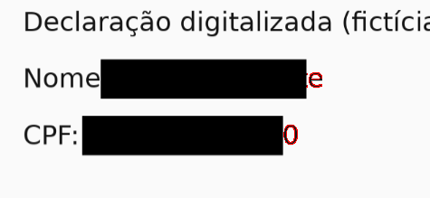
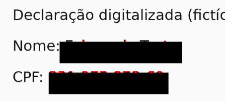

<!-- Tarja Livre — © 2026 Heraldo Antunes — Licença MIT (ver LICENSE) -->
# Prova da tarja do Tarja Livre 1.2.2

Pergunta: a tarja do Tarja Livre 1.2.2 apaga o conteúdo de verdade ou só cobre? Esta prova foi feita em 03/11/2026
no ramo `prova-tarja-1.2.2`, só com PDFs sintéticos e dados fictícios. A `main` não mudou e nada foi publicado.

**Resposta curta:** apaga.

- Em 14 casos, nenhuma das 7 ferramentas recuperou nada do PDF tarjado, e as mesmas ferramentas acharam os dados nos
  originais.
- O PDF salvo é refeito do zero: cada página vira uma imagem com as tarjas pintadas por cima, mais a folha de
  conferência. Nada do arquivo original passa para ele: nem texto, nem fontes, nem anotações, nem formulário, nem
  anexos, nem metadados, nem versões antigas.
- **Achado 1 (gravidade média):** quando o PDF tem uma camada de texto invisível (OCR) que não coincide com as letras
  da imagem, a tarja sugerida segue a camada invisível e pode deixar parte das letras à mostra na imagem salva.
  Não é conteúdo escondido que se recupera: são letras que continuam visíveis. Há um teste que falha mostrando isso.

## O que foi testado

### Versão

- A tag `v1.2.2` (`8196a82`), montada com `python3 scripts/montar.py`. Os dois HTML saíram iguais, byte a byte, aos
  da release publicada (conferido com o `SHA256SUMS.txt` da release):

  | HTML | SHA-256 |
  |---|---|
  | `TarjaLivre-1.2.2.html` | `b8ed12109244c4478dff72f5dbe0f124c3c51e313b1413134ecca827b4574357` |
  | `TarjaLivre-OCR-1.2.2.html` | `b735042bb6036c26a6eee68aa12e191d3bea19a0bc3eb141cdc090bd9f4de56f` |

- A `main` de hoje (`e3404f5`), que só muda a leitura do @ do OCR em `src/achados.js`. Ela deu o mesmo resultado nos
  28 testes, com os mesmos números de pixels.

### Como

1. **Casos.** [`tests/prova_tarja/gerar_casos.py`](../tests/prova_tarja/gerar_casos.py) (PyMuPDF 1.28.5) gera cada
   caso em duas versões: `original.pdf` e `sem-dados.pdf`, igual mas sem os dados. Os pixels que mudam entre as duas
   são exatamente os pixels dos dados na página.
2. **Tarjar pelo próprio programa.** [`tests/prova_tarja/tarjar.mjs`](../tests/prova_tarja/tarjar.mjs) abre o HTML
   direto do disco no Chromium 153 sem janela e faz o que uma pessoa faria:
   - abre o PDF e põe os nomes fictícios na lista de termos;
   - clica em **Procurar no documento** e em **Aceitar todas**;
   - faz as tarjas à mão onde a procura não alcança (só no caso da fonte sem mapa de texto);
   - passa por todas as páginas, marca **Revisei** e salva.

   O caso escaneado usa o HTML com OCR; os outros, o normal.
3. **Pixels.** O mesmo script desenha o original, o sem-dados e o tarjado a 150 ppp, a resolução do programa. Cada
   pixel dos dados tem de estar escuro no tarjado; o que não estiver é pintado de vermelho numa imagem.
4. **Recuperação.** [`tests/prova_tarja/recuperar.py`](../tests/prova_tarja/recuperar.py) procura cada dado (inteiro,
   cada palavra com 5 letras ou mais e os números sem pontuação, sem diferença de maiúsculas e acentos) com:

   | Ferramenta | O que faz |
   |---|---|
   | `pdftotext` (Poppler 24.02) | o texto das páginas |
   | `qpdf --qdf --object-streams=disable` (qpdf 11.9) | o arquivo descomprimido, todos os objetos à vista, byte a byte |
   | `mutool extract -a` (MuPDF 1.23) | imagens e fontes tiradas do arquivo, byte a byte |
   | `strings -a` (binutils 2.42) | o arquivo cru, em ASCII, UTF-16 LE e UTF-16 BE |
   | versões | o arquivo cortado em cada `%%EOF` (as versões guardadas por atualização incremental), com `pdftotext` e byte a byte |
   | metadados | `pdfinfo` e o XMP (`pdfinfo -meta`) |
   | anexos | `pdfdetach -list` e o conteúdo de cada anexo (`pdfdetach -saveall`) |

   Tudo rodou no original (controle: as ferramentas têm de achar) e no tarjado.

Para repetir, na raiz do repositório:

```bash
python3 scripts/montar.py
```

```bash
cd tests/prova_tarja && npm ci --ignore-scripts
```

```bash
CHROMIUM=/caminho/do/chrome PYTHON=/python/com/pymupdf node --test prova.test.mjs
```

O teste precisa também de `pdftotext`, `pdfinfo`, `pdfdetach`, `qpdf`, `mutool` e `strings` no PATH.

### Os casos

| Caso | O que tem |
|---|---|
| `texto-simples` | nome, CPF, matrícula e e-mail em Helvetica (base; o `tests/e2e.mjs` já prova este caso) |
| `fonte-subconjunto` | fonte TrueType embutida só com as letras usadas (subconjunto), com mapa para Unicode |
| `fonte-sem-tounicode` | o mesmo subconjunto **sem** o mapa para Unicode: a extração sai embaralhada e a procura não acha; tarjas à mão |
| `texto-girado` | nome a 30 graus e CPF a 90 graus |
| `duas-colunas` | duas colunas lado a lado, com um nome em cada uma e um CPF |
| `escaneado` | a página é uma imagem (200 ppp), sem texto; OCR do programa |
| `camada-ocr` | imagem com uma camada de texto invisível por cima, esticada até a largura das letras da imagem (como fazem os programas de OCR) |
| `camada-ocr-largura` | a mesma camada, **sem** esticar: mais estreita que as letras da imagem |
| `camada-ocr-deslocada` | a camada esticada, mas **6 pontos abaixo** das letras da imagem |
| `formulario` | campos de formulário preenchidos (nome e CPF) e um campo escondido com outro nome |
| `anotacoes` | caixa de texto anotada com o nome (impressa), nota adesiva com CPF e outro nome no texto e no autor, marca-texto com comentário |
| `metadados-anexos` | título, autor, assunto e palavras-chave com dados; XMP com nome e matrícula; um anexo do documento e um anexo na página |
| `incremental` | versão 1 com nome e CPF; versão 2 (atualização incremental) com a página trocada e outro nome; a versão 1 continua no arquivo |
| `texto-claro-miudo` | CPF em cinza quase branco e nome em letra de 3 pontos |

## Resultado: caso x ferramenta

Em cada célula: quantos dados a ferramenta achou **no original → no tarjado**. Na coluna de pixels: quantos pixels dos
dados ficaram à mostra no tarjado, do total.

| Caso | pdftotext | qpdf --qdf | mutool extract | strings | versões | metadados | anexos | pixels à mostra |
|---|---|---|---|---|---|---|---|---|
| texto-simples | 4 → 0 | 4 → 0 | 0 → 0 | 0 → 0 | 0 → 0 | 0 → 0 | 0 → 0 | 0 de 7011 |
| fonte-subconjunto | 2 → 0 | 0 → 0 | 0 → 0 | 0 → 0 | 0 → 0 | 0 → 0 | 0 → 0 | 0 de 3366 |
| fonte-sem-tounicode | 0 → 0 | 0 → 0 | 0 → 0 | 0 → 0 | 0 → 0 | 0 → 0 | 0 → 0 | 0 de 3366 |
| texto-girado | 1 → 0 | 2 → 0 | 0 → 0 | 0 → 0 | 0 → 0 | 0 → 0 | 0 → 0 | 0 de 3283 |
| duas-colunas | 3 → 0 | 3 → 0 | 0 → 0 | 0 → 0 | 0 → 0 | 0 → 0 | 0 → 0 | 0 de 3971 |
| escaneado | 0 → 0 | 0 → 0 | 0 → 0 | 0 → 0 | 0 → 0 | 0 → 0 | 0 → 0 | 0 de 3761 |
| camada-ocr | 2 → 0 | 2 → 0 | 0 → 0 | 0 → 0 | 0 → 0 | 0 → 0 | 0 → 0 | 0 de 3761 |
| camada-ocr-largura | 2 → 0 | 2 → 0 | 0 → 0 | 0 → 0 | 0 → 0 | 0 → 0 | 0 → 0 | **193 de 3761** |
| camada-ocr-deslocada | 2 → 0 | 2 → 0 | 0 → 0 | 0 → 0 | 0 → 0 | 0 → 0 | 0 → 0 | **294 de 3761** |
| formulario | 2 → 0 | 3 → 0 | 0 → 0 | 3 → 0 | 0 → 0 | 0 → 0 | 0 → 0 | 0 de 2547 |
| anotacoes | 1 → 0 | 3 → 0 | 0 → 0 | 3 → 0 | 0 → 0 | 0 → 0 | 0 → 0 | 0 de 1259 |
| metadados-anexos | 1 → 0 | 5 → 0 | 0 → 0 | 4 → 0 | 0 → 0 | 4 → 0 | 3 → 0 | 0 de 1416 |
| incremental | 1 → 0 | 1 → 0 | 0 → 0 | 0 → 0 | 2 → 0 | 0 → 0 | 0 → 0 | 0 de 1599 |
| texto-claro-miudo | 2 → 0 | 2 → 0 | 0 → 0 | 0 → 0 | 0 → 0 | 0 → 0 | 0 → 0 | 0 de 142 |

O registro completo está em [`tests/prova_tarja/resultados/`](../tests/prova_tarja/resultados/).

Como ler os zeros do original:

- No `escaneado` e na `fonte-sem-tounicode` não há texto legível por máquina, então só os pixels contam. No escaneado,
  o OCR do programa achou o nome e o CPF; na fonte sem mapa, as tarjas foram feitas à mão.
- O `mutool extract` 1.23 tira imagens e fontes, não anexos (esses ficam com o `pdfdetach`). Nas fontes não há texto,
  só desenho de letras.

Em todos os 14 tarjados:
- há **uma versão só** (um `%%EOF`), **nenhuma anotação** (`/Annots`), **nenhum formulário** (`/AcroForm`) e **nenhum
  anexo**;
- o `mutool extract` tira **um objeto só**, a imagem da página;
- os metadados são só os do programa: título "Documento tarjado", criador "Tarja Livre 1.2.2", produtor
  "jsPDF 4.2.1" e a data em que foi salvo.

## Achado 1: a tarja segue a camada de texto invisível, e não as letras da imagem

**Gravidade: média.**

**O que acontece.** Em PDF digitalizado que já vem com camada de texto (o OCR de uma impressora ou de outro
programa), o Tarja Livre procura nessa camada e põe a tarja sugerida onde ela diz que o texto está. Se a camada não
coincide com as letras da imagem, a tarja cobre o lugar errado ou só parte das letras, e o resto fica visível na
imagem salva:

- `camada-ocr-largura`: a camada é mais estreita que a imagem. Ficaram à mostra o fim do nome ("te" de "Teste") e o
  último algarismo do CPF ("0"), 193 pixels;
- `camada-ocr-deslocada`: a camada está 6 pontos abaixo. Ficou à mostra a metade de cima do nome e do CPF inteiros,
  294 pixels.

Em vermelho, o que ficou à mostra no PDF salvo:





Com a camada certa (`camada-ocr`), o resultado foi 0 pixel à mostra.

**Por que média, e não alta.**
- O que vaza fica à vista: está na tela durante a conferência obrigatória das páginas, igual ao PDF salvo. Não é
  conteúdo escondido que alguém tira do arquivo com ferramenta.
- Só acontece com camada de texto desalinhada, que é feita por outro programa.

**Por que não baixa.**
- A sugestão aparece como aceita e coberta, e a folha de conferência diz que "o texto coberto pelas tarjas não existe
  neste arquivo". Quem confia na sugestão pode não reparar em duas letras.
- No deslocado, a metade de cima das letras costuma bastar para ler um nome.

**Como reproduzir.**

1. Gere o caso: `python3 tests/prova_tarja/gerar_casos.py /tmp/casos` (precisa do PyMuPDF).
2. Abra `TarjaLivre-1.2.2.html` no navegador e abra `/tmp/casos/camada-ocr-largura/original.pdf`.
3. Em **Nomes e outros termos**, escreva `Fulano de Teste`. Clique em **Procurar no documento** e em
   **Aceitar todas**.
4. Veja na página: a tarja do nome não cobre o "te" do fim, e a do CPF não cobre o último "0".
5. Marque **Revisei** e salve. No PDF salvo, as mesmas letras continuam visíveis.

Com `camada-ocr-deslocada/original.pdf`, a tarja fica abaixo das letras e deixa a metade de cima delas à mostra.

**Teste que falha.** [`tests/prova_tarja/prova.test.mjs`](../tests/prova_tarja/prova.test.mjs): 28 testes, 26 passam.
Os 2 que falham, na 1.2.2 e na `main` de 03/11/2026 (antes da correção abaixo):

```
✖ camada-ocr-largura: todo pixel dos dados ficou escuro
  AssertionError: 193 de 3761 pixels dos dados à mostra no tarjado.pdf
✖ camada-ocr-deslocada: todo pixel dos dados ficou escuro
  AssertionError: 294 de 3761 pixels dos dados à mostra no tarjado.pdf
```

**Correção (ramo `corrige-camada-ocr`, depois da 1.2.2).** Foi escolhido conferir a caixa contra os pixels
escuros da imagem:
- Quando a página tem texto desenhado invisível (modos 3 e 7 do PDF), a procura desenha a página na resolução do PDF
  salvo.
- Cada caixa sugerida cresce até cobrir inteiras as palavras escuras da imagem que ela toca. A busca vai até 3 alturas
  de cada lado e 3/4 de altura acima e abaixo.
- A caixa só cresce, nunca diminui.

Com a correção, os 28 testes passam, e os dois casos ficaram com 0 pixel à mostra. O teste de regressão do
repositório é o `tests/e2e_camada_ocr.mjs`, que falha com o HTML da 1.2.2 e passa com a correção.

Limites que continuam:
- se a camada estiver tão fora do lugar que a caixa não encoste em nenhuma letra da palavra certa (por exemplo, uma
  linha inteira abaixo), a correção não acha a palavra;
- a ferramenta **Texto** (selecionar com o cursor) continua usando a camada invisível;
- a tarja pode sair um pouco maior que a palavra: no caso da camada estreita, ela cobriu também o ":" de "Nome:".

## Observações (não são vazamento do que foi tarjado)

1. **O nome do arquivo salvo** é o nome do original com `-tarjado` no fim. Um original chamado "Ficha de Fulano.pdf"
   sai "Ficha de Fulano-tarjado.pdf". Já é assim de propósito (os testes do repositório conferem o nome sugerido), mas
   o nome do arquivo não passa pela tarja.
2. **A folha de conferência traz o SHA-256 do original.** Ele não revela nada sozinho, mas quem tiver um arquivo
   candidato consegue confirmar se é o original. Também é de propósito.
3. **A data e a hora** em que o PDF foi salvo ficam nos metadados e na folha.
4. **O que não aparece na página não é sugerido e também não vai para o PDF salvo.** É o caso do texto da nota
   adesiva, do autor do comentário, do campo escondido, dos metadados, dos anexos e da versão antiga. A prova mostra
   que nada disso sobra no tarjado, mesmo sem tarja nenhuma por cima.

## O que não foi repetido nem testado

- **Não repetido**, porque já está provado em outro lugar:
  - a remoção do texto em PDF simples e a cobertura pixel a pixel do OCR (`tests/e2e.mjs`, `tests/e2e_ocr.mjs`,
    `tests/e2e_export_real.mjs`);
  - a leitura do e-mail pelo OCR (`docs/LINUX.md`, defeito 3, e as correções da 1.2.2).

  O `texto-simples` fica aqui só como base da tabela.
- **Não testado:**
  - o formato JPEG de saída (só o PNG, o padrão);
  - a tarja branca (só a preta);
  - camadas opcionais (OCG) e PDF com senha;
  - PDFs reais;
  - outros navegadores além do Chromium;
  - o `.exe` (a mesma página, dentro do WebView2).
